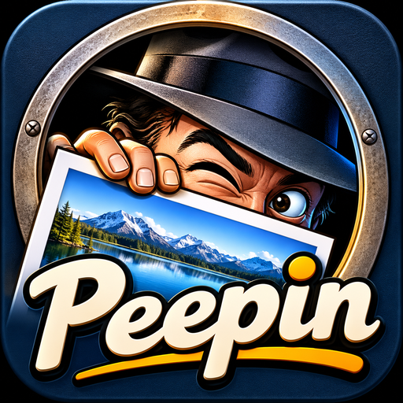
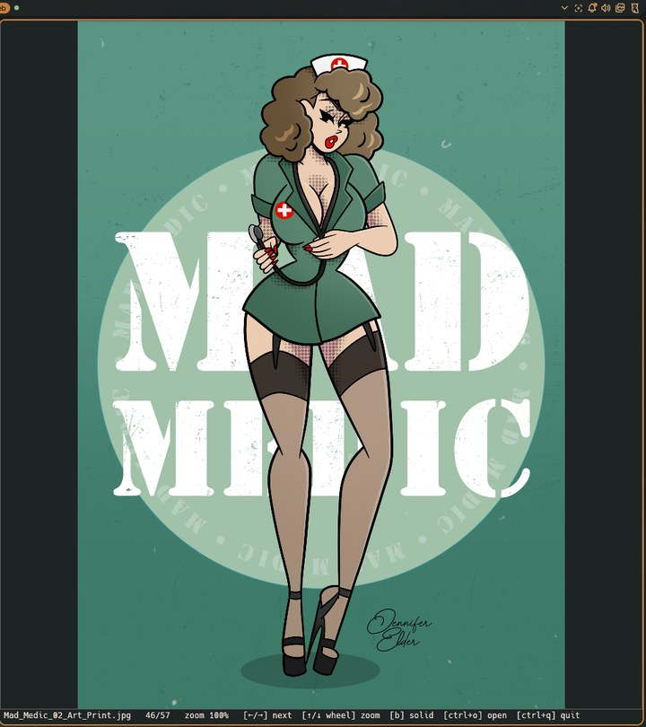
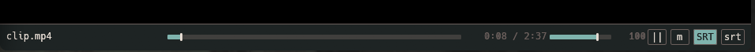

<p align="center"></p>

# peepin

A small image and video viewer for Linux with a terminal feel: a window with no
background of its own, monospace text in your terminal's colours, and the picture
fitted into whatever space the window has.



## What it does

- **Walks a folder.** `←` and `→` — or the mouse's side buttons — go from file
  to file, pictures and videos in one list.
- **Fits the picture** into the window, zooms with the wheel or `↑` `↓`, pans a
  zoomed picture by dragging, `0` fits it again.
- **Three backgrounds**: the desktop showing through, a blurred copy of the
  picture, or the terminal's background colour. `b` cycles them.
- **Video through mpv**, drawn *inside* peepin's window, with a bar under it:
  seek, clock, pause, mute, volume, and the subtitle track — including the ones
  baked into an MKV, listed with their language.
- **Reads the awkward formats**: `.dds` (Fallout's textures, BC1–BC7) by itself,
  and heic, jxl, psd, svg and camera raw through ImageMagick or the format's own
  tool.
- **Picker** `Ctrl+O`: folders on the left, files on the right, thumbnails on `v`.
- **Contact sheet** `F3`: the whole folder as polaroids; `Ctrl+S` saves it.
- **Batch rename** `F11`: `name-{n}`, with the first number typed in.
- **Save as** `Ctrl+S`: png, jpg, webp, bmp or tiff.
- **Screenshot** `p`: the window as it looks — picture, background, bars, video
  included — written as a PNG beside the file.
- **Your colours**: it reads kitty's config, and `F2` edits the rest.

## What it needs

| what | why |
|---|---|
| Linux with X11 or XWayland | the window itself. Video drawn *inside* the window needs XWayland; without it mpv opens its own window and the bar is not there |
| **mpv** | video. Without it peepin still shows pictures |
| **ImageMagick** (`magick`) | everything `image` cannot read: heic, jxl, psd, svg, camera raw — see [Formats](#formats). GraphicsMagick (`gm`), `heif-convert`, `djxl` and `vips` work in its place |
| Rust 1.85 or newer | to build it; the crate is edition 2024 |

Nothing else to install for the window: X11, Wayland, xkb and OpenGL are loaded
at run time, so no `-dev` packages are needed.

## Install

```sh
git clone https://github.com/madmedicnl/peepin
cd peepin
./install.sh
```

`install.sh` builds it and puts the binary in `~/.local/bin`, the icon in
`~/.local/share/icons` and a menu entry in `~/.local/share/applications`; at the
end it says which of the optional tools it found. `./install.sh --uninstall`
removes those again. By hand it is two lines:

```sh
cargo build --release
install -m755 target/release/peepin ~/.local/bin/peepin
```

The tools, on Arch:

```sh
sudo pacman -S --needed rust mpv imagemagick
```

on Debian or Ubuntu — with Rust from [rustup.rs](https://rustup.rs), since the
distribution's cargo is usually older than edition 2024 needs:

```sh
sudo apt install mpv imagemagick
```

A built `peepin-git` package is attached to the
[latest release](https://github.com/madmedicnl/peepin/releases) — download it and
`sudo pacman -U peepin-git-*.pkg.tar.zst`. Or build it yourself from the
`PKGBUILD` in `packaging/`; `packaging/README.md` says how:

```sh
mkdir -p ~/aur/peepin-git && cp packaging/PKGBUILD packaging/.SRCINFO ~/aur/peepin-git/
cd ~/aur/peepin-git && makepkg -si
```

## Open

```sh
peepin                       # empty; Ctrl+O to pick a file
peepin ~/Pictures/photo.jpg  # that file, and ← → walk its folder
peepin ~/Pictures            # the first picture in the folder
```

## Keys

| key | what |
|---|---|
| `←` `→` | previous / next file in the folder |
| mouse left / right button | previous / next (swappable, see below) |
| mouse wheel, `↑` `↓` | zoom in / out |
| middle-drag | pan a zoomed picture |
| `0` | fit to window again |
| `Ctrl`+`←` `→` `↑` `↓` | resize the window itself (works while floating) |
| `Ctrl+O` | file picker |
| `Ctrl+S` | save as: folder, name and format (png, jpg, webp, bmp, tiff) |
| `F1` | the key list |
| `F2` | settings panel (background, mouse buttons, colours) |
| `F3` | contact sheet of the folder, as polaroids |
| `F11` | batch rename the images in the folder |
| `b` | background: clear → blur → solid |
| `p` | screenshot of the window, saved beside the file |
| `space` (video) | pause / play |
| `↑` `↓` (video) | volume |
| `m` (video) | mute |
| `s` (video) | next subtitle track, off after the last |
| `0`–`9` (video) | subtitle track by number, `0` is off |
| `l` (video) | load a subtitle file from the folder |
| `Ctrl+Q` | quit |

## Video (mpv)

Videos are handed to **mpv**, which is told to draw into a window of peepin's
own, so the video sits in peepin's window and not in one of its own. The bar
under it is peepin's to draw:



| in the bar | what |
|---|---|
| the file name | |
| the seek bar | drag or click to jump; the clock is on its right |
| `\|\|` / `▶` | pause and play (`space`) |
| `m` | mute, lit while muted |
| `sub`, or `FRA` | the subtitle track. When one is showing, the label is its language. A click walks to the next track and off after the last; a **right click opens the list** — every track with its language and title, the one showing marked ●, and `off` at the top. Picking a track is followed by its name in the bar for a moment |
| `srt` | load a subtitle file from this folder: the one named after the video if there is one, else the first `.srt`, `.vtt`, `.ass`, `.ssa`, `.sub`, `.idx`, `.sup` |
| the volume bar | drag or click; the wheel over the bar does it too, and `↑` `↓`; 100 is mpv's normal level, up to 130 |
| a number | the volume in percent |

It all goes through mpv's IPC socket in `$XDG_RUNTIME_DIR` (removed with the
video), which is also why mpv keeps no keyboard and no mouse of its own: every
key still belongs to peepin.

Subtitles come from the file itself when it has them — an MKV usually carries a
few, and its first one is often already showing, because mpv picks one by its own
language rules. The chip then reads that track's language (`FRA`, `NED`, `ENG`),
`0`–`9` choose a track outright, and the right-click list names them all.

While that list is open the video is out of the way, since it is a child window
that would be drawn over the list; it comes back as soon as the list closes.

`srt` is for a subtitle that is a separate file next to the video; mpv loads one
with the video's exact name by itself, so `srt` is for the others.

Without XWayland there is no window of ours to give mpv: the video then opens in
a window of its own, the bar is not there, and the keys still work.

## Formats

Read by `image` itself: **png, jpg/jpeg, gif** (first frame), **bmp, tga,
tif/tiff, webp, qoi, hdr, exr, ico, pnm** (pbm/pgm/ppm/pam), **farbfeld/ff, avif**
and **dds** — Fallout's textures, block-compressed BC1–BC7 through `image_dds`,
with `image`'s own DDS reader as the fallback for uncompressed surfaces.

Read through a converter, the way IrfanView uses its plugins: **heic/heif, jxl,
jp2/j2k, psd, pcx, xcf, wmf/emf, svg** and camera raw (**cr2, cr3, nef, arw, dng,
orf, raf, rw2, pef, srw, 3fr, mrw**), plus **jxr/wdp/hdp**. These go through the
first of `magick`, `gm`, `heif-convert`, `djxl` or `vips` that is installed and
succeeds, written to a temporary PNG and read back. Without those tools the
formats simply report that they could not be read; the rest of the list does not
depend on them.

Read, as video (handed to mpv): **mp4, mkv, webm, avi, mov, m4v, wmv, flv, mpg,
mpeg, ts, ogv**. mpv itself plays more, but these are the extensions peepin
recognises; one line in `VIDEO_EXTS` adds another.

Written by Ctrl+S: **png, jpg** (quality 92, alpha on white), **webp** (lossless),
**bmp**, **tiff**.

Only a zoomed picture is dragged: at "fit" the left button is just the next file.

## Background

Three modes, `b` cycles them, `~/.config/peepin/peepin.conf` sets the one it
starts in:

```ini
background = transparent   # the desktop shows through (default look)
background = blur          # a blurred, dimmed copy of the picture fills the window
background = solid         # the terminal's background colour
```

Blur is the picture itself, downscaled to 48 px wide, blurred and stretched over
the window — no compositor support needed, and it works the same under X11 and
Wayland.

## Colours

The menu, status line and picker take their colours from your terminal: kitty's
`~/.config/kitty/kitty.conf` is read, `include` lines followed (this machine uses
`themes/noctalia.conf`). Override any of them in `~/.config/peepin/peepin.conf`:

```ini
color.fg     = #e4dad1   # text
color.bg     = #1e2424   # picker and status line background
color.dim    = #6b5f5c   # borders, secondary text
color.accent = #7fb3ad   # selection
```

`peepin --palette` prints what it resolved.

## Settings (F2)

The F2 panel edits the same file: background mode, which way each mouse button
walks, and the four colours. `Ctrl+S` (or *save*) writes `peepin.conf` and applies
it at once; `Esc` closes, `F2` toggles.

## Saving (Ctrl+S)

Writes the picture at its own size — not as zoomed on screen — to the folder and
name in the panel, in png, jpg (quality 92, alpha composited on white), webp
(lossless), bmp or tiff. With a contact sheet open, Ctrl+S saves the sheet.

## Screenshot (p)

`p` writes the window as it is on screen to `peepin-<date>-<time>.png` in the
folder of the file you are looking at (`peepin-20261120-143512.png`), with a
`-2`, `-3` when one already has that name. The picture, the background, the
status bar — and a video, because the window is read from the X server with its
children — are all in it, which makes it a good way to show what you see.

That last part is also why it needs the X11 window peepin already opens for mpv:
under a compositor without XWayland there is nothing to read and the bar says so.
The PNG keeps the window's transparency, so a "clear" background stays clear.

## Contact sheet (F3)

Every image in the folder as a polaroid: a white card, the picture kept in its own
proportions and centred, with the classic deeper bottom edge carrying the file
name (soft-wrapped over two lines, with an ellipsis when it does not fit), laid
out on a cream board (at most 96 images). Building it decodes every picture, so it
runs on its own thread and the window says *building contact sheet…* while it
works. Ctrl+S saves it; F3 or a new file closes it.

## Batch rename (F11)

`{name}` is the old stem, `{n}` the number (zero-padded to the folder's count), and
`start` is a field you type the first number into; the extension is kept. The
panel previews the first twelve names, and *rename* renames the images in two
passes, so a batch can never collide with itself. The folder is re-read afterwards
and the picture you were looking at stays selected, so the arrows keep working.

## Picker (Ctrl+O)

Two columns, like elio: folders on the left, images and videos on the right, the
path along the bottom edge in inverse video. It is drawn inside peepin's own
window (`--picker` opens it at start, which is how it was tested: `egui::Window`
does not appear under eframe's ui-based entry point).

| key | what |
|---|---|
| `↑` `↓` | move inside the focused column |
| `Tab`, `←`, `→` | switch column |
| `Enter`, `→` on a folder | open the folder or file under the cursor |
| `←` | one folder up |
| `Backspace` | one folder up |
| `v` | thumbnails beside the names, or names only |
| `Esc` | close |

With `v` on, the right column shows a 96 × 72 thumbnail for every row,
cover-cropped and cached per path. Only the rows on screen are decoded, and only
a couple per frame, so a folder of three hundred large DDS files fills in as you
look at it instead of freezing the window; a video, which has no still frame,
shows `▶`.

## Mouse buttons

`~/.config/peepin/peepin.conf`:

```ini
# prev or next — default is left = previous, right = next
mouse.left = prev
mouse.right = next
```

## Licence

peepin is free software under the **GNU General Public License, version 3 or
later** (GPL-3.0-or-later): you may use it, change it and pass it on under the
same terms, and it comes with no warranty. The full text is in `LICENSE`. The
icon in `assets/peep.png` belongs to the program.

## Notes

- The window is transparent: the picture sits on whatever is behind it. Under a
  compositor that ignores alpha it will look black instead.
- Zoom is relative to "fit", so `zoom 100%` means the picture exactly fills the
  window; it re-fits when you resize.
- The icon is the one in `assets/peep.png`; `install.sh` puts it in the icon theme
  and in a menu entry as well as on the window.
